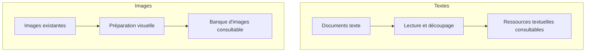
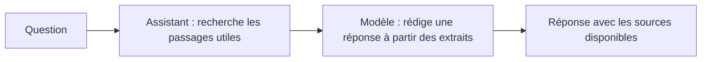
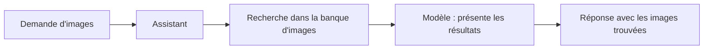
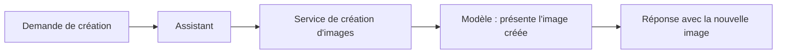

# Vue d'ensemble du projet

Cette page donne une vue générale du système : les contenus qui le nourrissent,
les actions qu'il peut réaliser et le chemin suivi entre une question et une
réponse. Elle explique les rôles sans entrer dans les détails techniques.

## À quoi sert le système ?

L'assistant accompagne la création d'un récit. Selon la demande, il peut :

- répondre à une question en s'appuyant sur les documents disponibles ;
- expliquer une notion ou aider à réfléchir à la cohérence d'une idée ;
- retrouver des images existantes dans la banque d'images ;
- demander la création d'une nouvelle image.

Retrouver une image et en créer une sont deux actions distinctes. Dans un cas,
l'assistant cherche parmi les images déjà fournies ; dans l'autre, il fait
appel à un service de création d'images.

## Préparation des ressources

Les deux parcours sont présentés séparément pour montrer que texte et images
sont préparés différemment. Ils deviennent ensuite consultables par
l'assistant. Une nouvelle image n'est pas ajoutée automatiquement à cette
banque : elle est créée à la demande pendant une interaction.

Le fonctionnement se déroule donc en deux temps :

1. **Préparer les ressources** pour rendre les documents et les images
   consultables.
2. **Répondre aux demandes** en retrouvant les ressources pertinentes et, si
   nécessaire, en utilisant une fonction de recherche ou de création d'image.

## Les rôles principaux

### Les ressources

Les documents texte apportent des informations et des idées auxquelles
l'assistant peut se référer. Les images forment une banque visuelle séparée,
dans laquelle une description peut servir à retrouver des images proches.

Ces ressources ne contiennent pas des réponses toutes faites : elles
fournissent des éléments que l'assistant peut mobiliser au moment de la
question.

### L'assistant et le modèle de langage

L'assistant reçoit la demande, prépare les ressources utiles et organise les
actions. Le modèle de langage interprète la formulation, suit les consignes
pédagogiques et rédige une réponse adaptée.

Le modèle ne va pas lui-même ouvrir les dossiers de documents ou d'images.
L'assistant lui transmet les extraits retrouvés et peut lui proposer des
fonctions à utiliser.

### Les outils

Un outil est une action concrète que l'assistant peut demander au programme
d'effectuer :

- **Recherche d'images** : retrouver des images existantes correspondant à
  une description.
- **Création d'image** : demander à un service externe de produire une nouvelle
  image à partir d'une description.

Le modèle choisit de demander ou non un outil en fonction de la demande et des
consignes. Une demande de création déclenche la création ; une demande de
recherche d'images utilise la banque. Si la demande est ambiguë, la recherche
d'images existantes est privilégiée.

## Parcours d'une question

Les trois schémas ci-dessous montrent les parcours possibles séparément. Chaque
schéma se lit de gauche à droite.

### Question sur les documents

### Recherche d'une image existante

### Création d'une nouvelle image

Pour chaque question, l'assistant recherche d'abord des passages dans les
documents texte. Il utilise la banque d'images ou le service de création
uniquement si la demande le justifie.

## Exemple : une demande, plusieurs types de réponse

| Demande | Parcours général |
|---|---|
| « Où se situe le complexe ? » | L'assistant cherche dans les documents et répond avec les sources disponibles. |
| « Est-ce cohérent que notre personnage médiéval utilise un téléphone ? » | L'assistant aide à identifier ce qui mérite réflexion et laisse les élèves choisir. |
| « Montre-nous des images de danseurs dans une forêt. » | L'assistant recherche des images dans la banque existante et présente les résultats. |
| « Crée une image d'un danseur dans une forêt brumeuse. » | L'assistant demande la création d'une nouvelle image. |

Le style et le contenu de la réponse varient donc selon l'intention : réponse
documentée, aide à la réflexion, résultats d'images ou nouvelle image. Si les
documents ne permettent pas de répondre à une question, l'assistant doit le
signaler plutôt que d'inventer une information provenant des ressources.

Pour savoir où l'assistant est défini et comment ajouter un nouvel outil,
consulter [H — Assistant et outils](./H-assistant-et-outils.md).
